<div align="center">

<!-- HERO BANNER -->


<br/><br/>

<!-- DYNAMIC TYPING SVG INTRO -->
<a href="https://github.com/januuthayan1967-cloud">
  
</a>

<br/>

<!-- QUICK BADGES / STATUS -->
<p align="center">
  <a href="https://portfolio-website-src.vercel.app/" target="_blank">
    
  </a>
  <a href="https://www.linkedin.com/in/uthayagunasingam-vanojan-1b75a2327/" target="_blank">
    
  </a>
  <a href="mailto:uthayanvanojan5@gmail.com">
    
  </a>
  
</p>

</div>

---

### ✦ Executive Summary

Graduate Software Engineer with an academic foundation in **Computing and Software Engineering** from **ICBT Campus** affiliated with **Cardiff Metropolitan University, UK**. 

Experienced in architecting end-to-end full-stack applications with the **MERN stack**, engineered native mobile applications in **Java / Android SDK** with automated testing suites (JUnit & Robolectric), and built distributed systems integrating **Computer Vision & AI microservices** (MobileNetV3, OpenCV, Gemini AI). Focused on clean architecture, RESTful API design, database integrity, and scalable cloud deployments.

- 🎓 **Education:** BSc (Hons) in Software Engineering *(coursework completed, results pending)* & HND in Computing & Software Engineering *(Graduated 2025)*.
- ⚡ **Core Strengths:** Full-Stack Architecture, Clean Code Practices, Test-Driven Development, Relational & NoSQL Modeling, Real-Time WebRTC Streaming.
- 🎯 **Target Roles:** Graduate Software Engineer, Associate Full-Stack Developer, Junior Backend / Mobile Engineer.

---

### ✦ Verified Technical Stack

<div align="center">

#### ⬡ Programming Languages
<p align="center">
  
  
  
  
  
  
  
  
  
</p>

#### ⬡ Frontend Engineering
<p align="center">
  
  
  
  
  
</p>

#### ⬡ Backend & Distributed Systems
<p align="center">
  
  
  
  
  
  
  
</p>

#### ⬡ Databases & Cloud Storage
<p align="center">
  
  
  
  
</p>

#### ⬡ Mobile Development & Quality Assurance
<p align="center">
  
  
  
  
  
</p>

#### ⬡ Cloud Infrastructure & Tooling
<p align="center">
  
  
  
  
  
</p>

</div>

---

### ✦ Featured Engineering Projects

<table>
  <tr>
    <td width="50%" valign="top">
      <h3 align="left">🩺 01. Smart Oral Disease Detection & Telehealth</h3>
      <p><strong>BSc Capstone Flagship Platform</strong></p>
      <p>An intelligent dual-engine healthcare platform combining automated deep learning screening with real-time specialist teleconsultation.</p>
      <ul>
        <li><strong>AI Screening:</strong> Python Flask microservice utilizing <code>MobileNetV3</code> transfer learning & <code>OpenCV</code> image preprocessing to detect oral cancer, leukoplakia, and benign lesions.</li>
        <li><strong>Telehealth:</strong> Real-time WebRTC audio/video consultations, clinical appointment scheduling, and automated PDF medical report generation.</li>
        <li><strong>Security:</strong> Role-Based Access Control (RBAC) separating patients, doctors, and hospital administrators.</li>
      </ul>
      <p>
        <strong>Tech Stack:</strong> <code>React</code> • <code>Node.js</code> • <code>Flask</code> • <code>MobileNetV3</code> • <code>OpenCV</code> • <code>Gemini AI</code> • <code>MongoDB</code> • <code>WebRTC</code>
      </p>
      <p>
        🔗 <a href="https://smart-oral-disease-detection.vercel.app" target="_blank"><strong>Live Production App</strong></a>
      </p>
    </td>
    <td width="50%" valign="top">
      <h3 align="left">💼 02. Internship Finder SaaS Platform</h3>
      <p><strong>Full-Stack Enterprise Recruitment Portal</strong></p>
      <p>A comprehensive career marketplace engineered for seamless candidate discovery, verified employer job listings, and integrated candidate assessments.</p>
      <ul>
        <li><strong>Live Interviews:</strong> Embedded low-latency video interview rooms powered by <code>ZEGOCLOUD WebRTC</code> with synchronized status transitions.</li>
        <li><strong>Application Tracking:</strong> Comprehensive pipeline tracking applications across <em>Applied</em>, <em>Shortlisted</em>, <em>Interviewing</em>, and <em>Hired</em>.</li>
        <li><strong>Asset Management:</strong> Cloudinary-integrated resume parsing, secure JWT sessions, and custom recruiter dashboards.</li>
      </ul>
      <p>
        <strong>Tech Stack:</strong> <code>React 18</code> • <code>Tailwind CSS</code> • <code>Node.js</code> • <code>Express.js</code> • <code>MongoDB Atlas</code> • <code>ZEGOCLOUD</code>
      </p>
      <p>
        🔗 <a href="https://github.com/januuthayan1967-cloud/internship-finder" target="_blank"><strong>GitHub Repository</strong></a>
      </p>
    </td>
  </tr>
  <tr>
    <td width="50%" valign="top">
      <h3 align="left">🏨 03. LuxeVista Resort Native Android Suite</h3>
      <p><strong>Native Java Hospitality Booking & Management</strong></p>
      <p>A native Android application designed for high-end luxury resort bookings, villa reservations, and automated PDF billing vouchers.</p>
      <ul>
        <li><strong>Local Persistence:</strong> Relational SQLite engine featuring 6 schema migrations with defensive transaction management.</li>
        <li><strong>Automated Quality:</strong> Comprehensive test harness with <strong>53 automated unit and integration tests</strong> (JUnit 4 & Robolectric) achieving 100% pass rate.</li>
        <li><strong>Vector Graphics & PDF:</strong> Dynamic booking voucher generation using Android <code>Canvas</code> and native PDF rendering.</li>
      </ul>
      <p>
        <strong>Tech Stack:</strong> <code>Java</code> • <code>Android SDK 35</code> • <code>SQLite</code> • <code>JUnit 4</code> • <code>Robolectric</code> • <code>Android Canvas</code>
      </p>
      <p>
        🔗 <a href="https://github.com/januuthayan1967-cloud/LuxeVistaResortApp" target="_blank"><strong>GitHub Repository</strong></a>
      </p>
    </td>
    <td width="50%" valign="top">
      <h3 align="left">🌌 04. 3D Cinematic Portfolio & Admin Engine</h3>
      <p><strong>Interactive Personal Branding & Real-Time CMS</strong></p>
      <p>High-performance single-page portfolio featuring real-time 3D orbital constellations and a password-protected administrative console.</p>
      <ul>
        <li><strong>Interactive Graphics:</strong> Canvas-accelerated 3D orbital particles and custom interactive physics built with Three.js and Framer Motion.</li>
        <li><strong>Executive CMS:</strong> Dynamic project showcase management, real-time CV Cloudinary synchronization, and visitor inquiry analytics.</li>
        <li><strong>Backend Engine:</strong> Authenticated Node.js / Express API backed by MongoDB Atlas with responsive, zero-downtime deployment on Vercel.</li>
      </ul>
      <p>
        <strong>Tech Stack:</strong> <code>React</code> • <code>Three.js</code> • <code>Framer Motion</code> • <code>Node.js</code> • <code>MongoDB Atlas</code> • <code>Cloudinary</code>
      </p>
      <p>
        🔗 <a href="https://portfolio-website-src.vercel.app/" target="_blank"><strong>Live Production Platform</strong></a> • <a href="https://github.com/januuthayan1967-cloud/portfolio-website" target="_blank"><strong>GitHub Repository</strong></a>
      </p>
    </td>
  </tr>
</table>

---

### ✦ Academic Credentials

```yaml
- Qualification: BSc (Hons) in Software Engineering
  Awarding Body: Cardiff Metropolitan University, United Kingdom
  Institution:   ICBT Campus, Sri Lanka
  Timeline:      2025 – 2026
  Status:        Coursework completed • Final examination results pending
  Focus Areas:   Distributed Systems, Advanced Software Design, Applied AI / Computer Vision, Enterprise Architecture

- Qualification: Higher National Diploma (HND) in Computing & Software Engineering
  Awarding Body: ICBT Campus, Sri Lanka
  Timeline:      2023 – 2025
  Status:        Completed (Graduated)
  Focus Areas:   Full-Stack Web Engineering, Mobile Systems, Database Management Systems, Data Structures & Algorithms

- Qualification: G.C.E. Advanced Level in Physical Science
  Curriculum:    Ministry of Education, Sri Lanka
  Timeline:      Completed 2021
  Subjects:      Physics, Combined Mathematics, Chemistry
```

---

### ✦ Dynamic GitHub Telemetry

<div align="center">

<table border="0">
  <tr>
    <td align="center">
      
    </td>
    <td align="center">
      
    </td>
  </tr>
  <tr>
    <td colspan="2" align="center">
      
    </td>
  </tr>
</table>

<p align="center">
  <sub><em>Note: Language metrics reflect codebase file distributions across public repositories and are dynamically aggregated by GitHub.</em></sub>
</p>

</div>

---

### ✦ Professional Connect & Inquiries

<div align="center">

Are you looking for a dedicated **Graduate Software Engineer** or **Associate Full-Stack Developer** with solid fundamentals and a proven track record of shipping production-quality software? Let's connect!

<br/>

<a href="https://portfolio-website-src.vercel.app/" target="_blank">
  
</a>
&nbsp;
<a href="https://www.linkedin.com/in/uthayagunasingam-vanojan-1b75a2327/" target="_blank">
  
</a>
&nbsp;
<a href="mailto:uthayanvanojan5@gmail.com">
  
</a>
&nbsp;
<a href="https://github.com/januuthayan1967-cloud">
  
</a>

<br/><br/>

```text
┌────────────────────────────────────────────────────────────────────────┐
│  Available for on-site, hybrid, or remote opportunities worldwide.     │
│  Response window: Within 24 business hours.                            │
└────────────────────────────────────────────────────────────────────────┘
```

<br/>

<p align="center">
  <sub>Crafted with precision • Black &amp; Gold Luxury Edition • © 2026 Uthayagunasingam Vanojan</sub>
</p>

</div>
